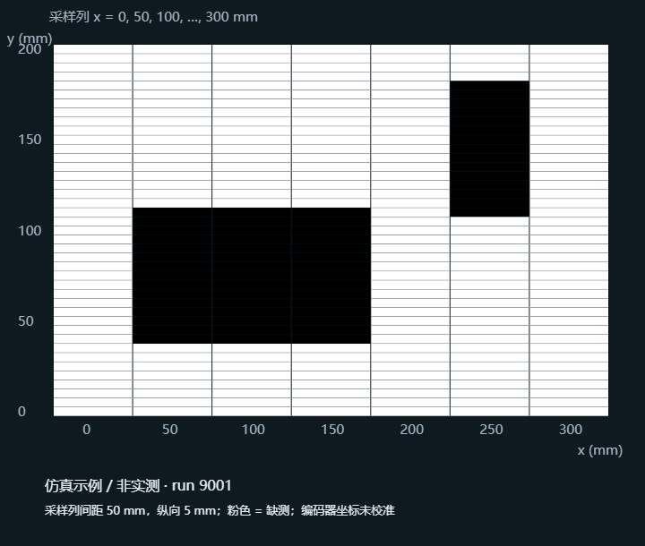

# Kit32 Raster Scan

使用 M5StampC3 / ESP32-C3 控制 Pololu 3Pi+ 小车，沿蛇形路线采集最中间的 DN3 地面反射传感器，生成原始读数矩阵和灰度可视化。

## 扫描行为

- 纵向行程 200 mm，横向范围 300 mm。
- 用户手动放在左下角，车头朝上；不需要起点黑带或自动定向。
- 纵向走 200 mm，转 90°，横移 50 mm，再转 90°，交替上下扫描。
- 共 7 条测线、6 次横移，平移总路程 1700 mm，完成后停车。
- 编码器估计距离、角度并纠偏；旋转 PWM 35，前进基值 45，接近直线终点时降到 35。
- 支持 STOP、读取失败停车、编码器无进展停车和单段超时停车。

## 数据和可视化

只把 DN3 记录到地图矩阵。纵向每 5 mm 一个采样格，横向测线相隔 50 mm，输出为 41 行 × 7 列。同一格内对新鲜读数取均值并保留次数与编码器估计采样位置。缺测值为 null / CSV 空白，不插值。转弯和横移不写矩阵，但逐帧日志仍记录 DN3。

坐标原点在左下角，x 向右、y 向上。CSV 第一行是 y=0，第一列是 x=0；图像顶部显示 y=200。默认灰度按最小/最大值拉伸，高原始读数显示更暗；可以输入实测黑白样本作 0–255 映射并反转显示。原始数据始终保留。

网页支持实时轨迹、矩阵、CSV / JSON / PNG 下载和历史 JSON 导入。本机服务将实测记录自动保存到 `web_console/results/`，包括原始值矩阵、逐帧读数、JSON 和相对灰度 SVG。



## 固件安装

开发环境：Arduino IDE 或 Arduino CLI，M5Stack ESP32 3.3.9、LIS3MDL 2.0.0、LSM6 2.0.1。

1. 本私有仓库已包含当前热点的 `firmware/Kit32_StampC3/WifiCredentials.h`。换热点时编辑此文件；`WifiCredentials.example.h` 保留为空白配置模板。
2. 电脑继续连接上网 Wi-Fi，同时开启 2.4 GHz 移动热点。
3. 用 USB 连接自己的小车，确认实际 CH9102 串口。
4. 编译并上传，示例中的 COM8 必须替换为实际端口：

```powershell
arduino-cli compile --fqbn m5stack:esp32:m5stack_stamp_c3:CDCOnBoot=default firmware/Kit32_StampC3
arduino-cli upload --port COM8 --fqbn m5stack:esp32:m5stack_stamp_c3:CDCOnBoot=default firmware/Kit32_StampC3
```

小车从电脑热点获取 DHCP 地址。可以在 Windows 热点已连接设备列表中查看，或读取串口输出 `INFO,WIFI_IP,...`。热点重开后地址可能变化。

## 运行网页

需要 Node.js 20 或更新版本。没有第三方 npm 依赖。

```powershell
npm test
npm start
```

打开 http://127.0.0.1:8766/，填写小车实际 IP，再连接。也可以在启动前设置 `KIT32_HOST` 环境变量作为默认地址。本机转接器目前支持 Windows 移动热点的 `192.168.137.x` 网段。

连接仅查询 PING / STATUS / DUMP，不自动运动。放好小车后点击“开始蛇形扫描”。电池供电并确认无线读数正常后可拔掉 USB。

小车保存最近一轮矩阵直到重新扫描或断电；停止后可以用“取回车内矩阵”重传。运行中返回 ERR,DUMP_BUSY。网页断线不会自动取消板载扫描，扫描仍会按完成条件或故障条件停车。请使用 STOP 主动中止。

## 精度和范围限制

- 7 条相隔 50 mm 的测线不等于连续全覆盖，可能漏掉线间的小图案。矩阵的宽列不表示传感器拥有 50 mm 视野。
- 原始读数不是 lux 或相机像素；灰度图是读数的显示映射。
- `OdometryModel.h` 的轮半径 16 mm、轮距 90 mm、每圈 358.3 计数是未实测校准的初值。
- `Controller.h` 中 `SENSOR_FORWARD_MM=0` 是未测量假设。应测量 DN3 相对轮轴的向前偏移后再调整。
- 200×300 mm 是参考点扫描行程，不保证车身始终处于同样大小的黑框内。需留车身和原地转弯边距，或缩小行程。
- 黑色形状作为地面图案测量，不触发避障或边界停车；本项目不处理凸起障碍。
- 已完成板级编译、上传校验、待机遥测和数据流程/网页仿真检查；尚未完成完整实车扫描、距离转角标定和真实图案重建验证。

## 文件结构

```text
firmware/Kit32_StampC3/  状态机、硬件接口、编码器模型、Wi-Fi 配置模板
web_console/            网页、协议解析、本机桥接、测试
examples/               明确标为非实测的合成灰度示例
```

14 字段基础遥测保持兼容；SCAN,BEGIN / META / STATE / CELL / END / DUMP_BEGIN / DUMP_END 提供地图协议。

## 凭据与许可

按所有者明确要求，本私有仓库包含当前实际 Wi-Fi 配置、已编译扫描固件、借用车原始 Flash 备份和项目历史版本压缩包。位置分别为 `firmware/Kit32_StampC3/WifiCredentials.h`、`firmware/prebuilt/`、`backups/original/`、`backups/releases/`。这些备份的内容也可能包含热点凭据。仓库保持私有。

保留原项目附带的 `firmware/Kit32_StampC3/LICENSE_Freenove_WS2812_Lib_for_ESP32`。项目包含课程示例和后续修改；本仓库没有对全部来源重新授予开源许可，公开分发前请确认课程代码的使用条款。
